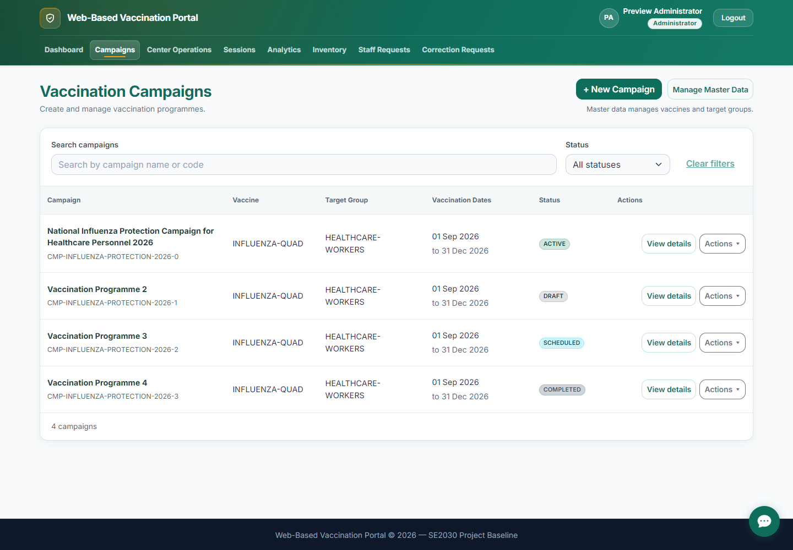
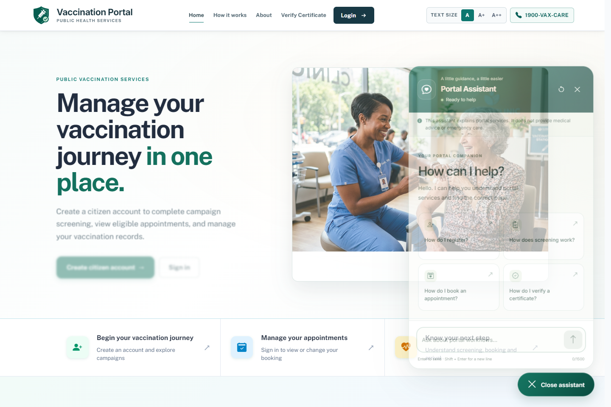
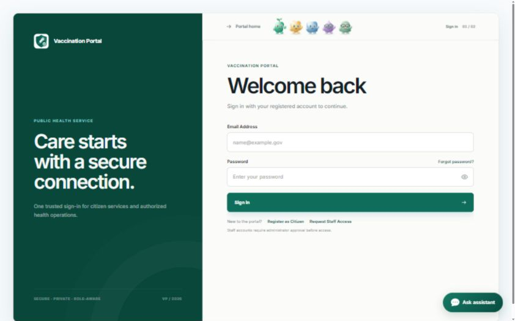
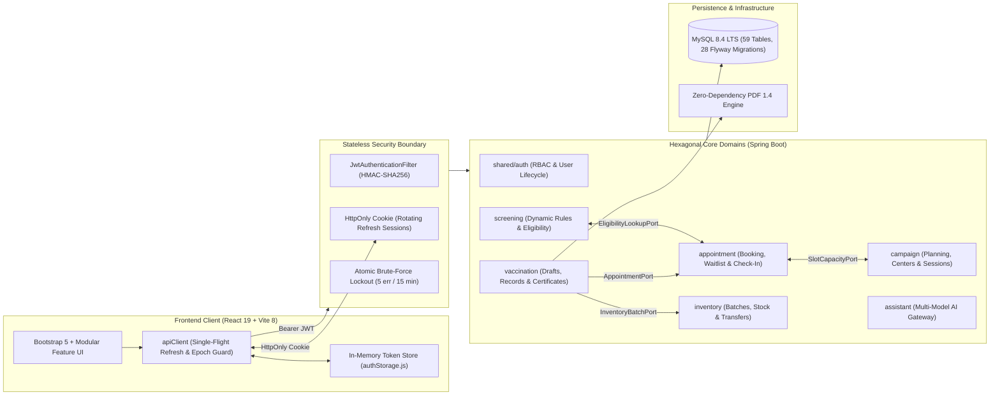
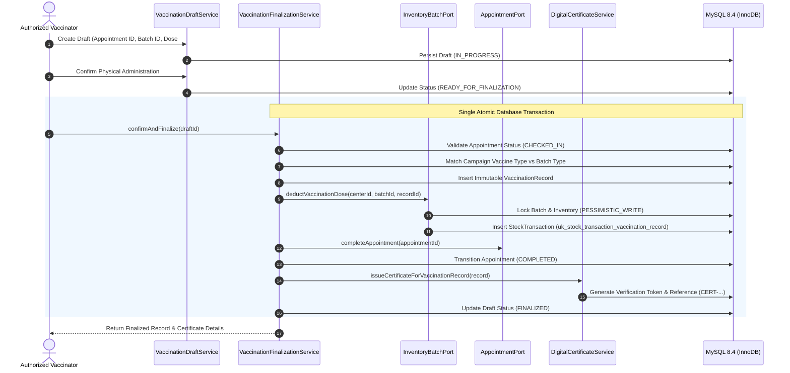

# Web-Based Vaccination Portal (WBVP)

<div align="center">

[](https://openjdk.org/projects/jdk/21/)
[](https://spring.io/projects/spring-boot)
[](https://react.dev/)
[](https://vitejs.dev/)
[](https://www.mysql.com/)
[](https://flywaydb.org/)
[](https://github.com/Sankalpa-KMCP/se2030-2026-y2-s1-mtr-01-vaccination-portal/actions)
[](LICENSE)

<br/>

**An enterprise-grade healthcare orchestration platform engineered with hexagonal architecture, strict concurrency guarantees, zero-compromise session security, and verifiable digital health certification.**

[Key Feats](#-key-engineering-achievements) • [Visual Showcase](#-visual-interface--experience-showcase) • [System Architecture](#-system-architecture) • [Core Modules](#-core-domain-modules) • [Quickstart](#-3-minute-quickstart) • [Demo Credentials](#-seeded-demo-accounts) • [Testing Rigor](#-testing--quality-pyramid)

</div>

---

## 📌 Executive Summary

The **Web-Based Vaccination Portal (WBVP)** is a full-stack, distributed healthcare platform designed to orchestrate large-scale vaccination campaigns. Architected as a **Hexagonal Modular Monolith** (Ports and Adapters), it manages the complete immunization lifecycle—from dynamic pre-vaccination clinical screening and capacity-locked appointment scheduling to inventory lot tracking, two-phase clinical dose administration, tamper-evident digital certificate generation, and an integrated conversational AI assistant.

---

## 🏆 Key Engineering Achievements

### 1. High-Concurrency & Zero-Oversell Guarantees
- **3-Level Hierarchical Pessimistic Locking**: Eliminates cyclic database deadlocks by enforcing deterministic lock acquisition ordering during slot booking:
  $$\text{VaccinationCampaign} \longrightarrow \text{VaccinationSession} \longrightarrow \text{TimeSlot}$$
  All locks are acquired via `SELECT ... FOR UPDATE` before re-evaluating remaining capacity under the active transaction, eliminating Time-of-Check to Time-of-Use (TOCTOU) race conditions.
- **Citizen-Campaign Guard-Row Mutexes**: Employs dedicated guard rows (`citizen_campaign_booking_guard`) to serialize concurrent cross-table operations (booking, waitlist intake, rescheduling, promotions) without coarse table-wide locking, preventing dual holdings.
- **Deterministic FIFO Waitlist Engine**: Promotes waitlisted candidates in strict temporal order (`joined_at ASC, id ASC`) upon appointment cancellations or capacity expansion, automatically bypassing unverified candidates without burning capacity or stalling queues.

### 2. Zero-Compromise Security & Session Defense
- **Memory-Only Access Token Storage**: JWT access tokens are held exclusively in browser module memory (`memoryToken`). No sensitive tokens are persisted to `localStorage` or `sessionStorage`, eliminating XSS token harvesting vectors.
- **Single-Use Rotating Refresh Tokens with Family Revocation**: Refresh tokens are 256-bit cryptographically secure random values transmitted via `HttpOnly`, `SameSite=Lax`, `Secure` cookies; only SHA-256 hashes are persisted. Atomic rotation claims (`claimForRotation`) detect token theft; re-presentation of an already rotated token immediately revokes the entire token family.
- **Atomic Brute-Force Login Lockout**: Failed login counters and timed lockouts (5 attempts / 15-minute lock) are enforced via single-query atomic SQL updates, avoiding read-modify-write lost-update races. Configured with `@Transactional(noRollbackFor = BadCredentialsException.class)` to ensure security tallies commit even upon rejected authentication.

### 3. Two-Phase Clinical Finalization & Zero-Dependency PDF Engine
- **Two-Phase Clinical Administration**: Vaccinators create an in-progress draft specifying dose number, vaccine batch, and physical administration confirmation. Finalization executes in a **single atomic transaction** coordinating:
  1. Immutable `VaccinationRecord` creation.
  2. Inventory lot deduction (`InventoryBatchPort.deductVaccinationDose`).
  3. Appointment lifecycle closure (`AppointmentValidationPort.completeAppointment`).
  4. Digital certificate issuance (`DigitalCertificateService.issueCertificateForVaccinationRecord`).
- **Zero-Dependency PDF 1.4 Generator**: Pure Java binary ISO 32000 / PDF 1.4 rendering engine constructed without third-party libraries (no Apache PDFBox, no iText), eliminating heavy dependencies, CVE attack surface, and licensing liabilities while producing official, tamper-evident certificates with verification tokens.
- **Privacy-Preserving Public Verification**: `/api/v1/vaccination/certificates/verify/{token}` allows third parties to confirm certificate authenticity without exposing patient PII (National ID, date of birth, contact details).

### 4. Deterministic AI Assistant Subsystem
- **Multi-Provider Adapter Architecture**: Pluggable AI engine supporting OpenAI, Google Gemini, and local offline Ollama models with graceful fallback.
- **Deterministic Refusal Policies**: `AssistantRefusalPolicy` intercepts and rejects medical triage, prescription requests, prompt injections, and database mutations.
- **Principal-Bound Domain Tools**: Read-only tools (`MyAppointmentsAssistantTool`, `MyEligibilityAssistantTool`, `MyStaffScheduleAssistantTool`) bound strictly to authenticated JWT claims, preventing prompt-injection identity tampering.

### 5. AST-Enforced Architecture Boundaries
- **Custom ESLint Architecture Rule**: `frontend/eslint/featureBoundaries.js` enforces hexagonal modularity at compile time:
  - Shared infrastructure cannot import business feature slices.
  - Feature domains cannot access private internals of sibling features.
  - Routing primitives are restricted to composition roots.

---

## 📸 Visual Interface & Experience Showcase

<table>
  <tr>
    <td width="50%" align="center">
      <strong>Clinic & Campaign Management Console</strong><br/>
      <br/>
      <em>Real-time operational campaign management, status lifecycle tracking, and session capacity planning.</em>
    </td>
    <td width="50%" align="center">
      <strong>Conversational Healthcare AI Assistant</strong><br/>
      <br/>
      <em>Multi-provider AI assistant with deterministic safety guardrails, guided deep-links, and personalized lookups.</em>
    </td>
  </tr>
  <tr>
    <td width="50%" align="center">
      <strong>Multigenerational Citizen Care Pathway</strong><br/>
      <br/>
      <em>Accessible public landing and reactive citizen journey stepper spanning screening, booking, and certificates.</em>
    </td>
    <td width="50%" align="center">
      <strong>Procedural Gaze-Tracking Security Mascots</strong><br/>
      <br/>
      <em>Interactive 3D companion characters with dynamic eye-tracking and state-aware feedback during authentication.</em>
    </td>
  </tr>
</table>

---

## 🏛 System Architecture

The application is structured as a **Hexagonal Modular Monolith** in Java 21 / Spring Boot paired with a modular React 19 Single Page Application.



---

## 🔄 Two-Phase Clinical Administration Workflow



---

## 📦 Core Domain Modules

| Module | Backend Package | Frontend Slice | Primary Responsibilities & Invariants |
| :--- | :--- | :--- | :--- |
| **Shared Auth** | `shared/auth` | `src/auth/` | In-memory 15-min JWTs, rotating refresh cookies, atomic lockout, citizen self-service, staff account approval. |
| **MF-01 Screening** | `screening` | `features/screening/` | Dynamic clinical questionnaire builder, polymorphic answer validators, submission versioning, eligibility determinations. |
| **MF-02 Campaign** | `campaign` | `features/campaign-management/` | Vaccine campaigns, center operating hours, recurrence rules, time slot capacity, and clinic rostering. |
| **MF-03 Appointment** | `appointment` | `features/appointment-management/` | Slot reservation, guard-row locking, appointment rescheduling, FIFO waitlist promotion, arrival check-in. |
| **MF-04 Inventory** | `inventory` | `features/inventory-management/` | Vaccine manufacturers, batch expiry tracking, center stock allocation, adjustments, inter-center transfers. |
| **MF-05 Vaccination** | `vaccination` | `features/vaccination-administration/` | Clinical drafts, atomic finalization, immutable medical records, append-only corrections, zero-dependency PDF certificates. |
| **AI Assistant** | `assistant` | `features/assistant/` | Pluggable conversational assistant (OpenAI, Gemini, Ollama), deterministic safety policy, principal-scoped tools. |

---

## 🚀 3-Minute Quickstart

### Prerequisites
- **Java**: JDK 21+ (Eclipse Temurin recommended)
- **Node.js**: Node 22.x or 24.x (npm 9+)
- **Container Engine**: Docker Desktop or Docker Engine with Docker Compose

### 1. Launch Backing Database
```bash
docker compose --env-file database/.env up -d mysql
```
*MySQL 8.4 LTS initializes at `localhost:3306/vaccination_portal`. 28 Flyway migrations apply automatically on Spring Boot launch.*

### 2. Start Backend API
```bash
cd backend
./mvnw spring-boot:run
```
*Backend runs at `http://localhost:8080`. Verify system health at `http://localhost:8080/actuator/health`.*

### 3. Start Frontend Client
```bash
cd frontend
npm install
npm run dev
```
*Frontend runs at `http://localhost:5173`. API requests to `/api` are automatically proxied to the backend.*

---

## 👥 Seeded Demo Accounts

The database comes pre-seeded with authoritative roles for evaluation:

| Role | Email | Password | Primary Interface & Permissions |
| :--- | :--- | :--- | :--- |
| **System Administrator** | `admin@demo.org` | `Admin123!` | `/app/admin` — Full platform analytics, staff request approvals, system configuration. |
| **Authorized Vaccinator** | `vaccinator@demo.org` | `Staff123!` | `/app/vaccinator` — Clinical session check-in queue, vaccination drafts, finalization. |
| **Healthcare Officer** | `healthcare@demo.org` | `Staff123!` | `/app/screening/reviews` — Questionnaire assignment, citizen eligibility reviews. |
| **Center Manager** | `manager@demo.org` | `Staff123!` | `/app/center-operations` — Center hours, clinic closure planning, staff rostering. |
| **Verified Citizen** | `citizen@demo.org` | `Citizen123!` | `/app/citizen` — Screening forms, appointment booking, digital certificate downloads. |

---

## 🧪 Testing & Quality Pyramid

The codebase enforces strict test-driven quality across all architectural layers:

```
                  ▲
                 / \
                /   \     E2E Verification (Manual & Automated Slices)
               /-----\
              /       \    MySQL Testcontainers (56 tests)
             /         \   Real MySQL 8.4, Collation, Dynamic Locks, Concurrency Stress
            /-----------\
           /             \  Component & Slice Tests (1,265+ Vitest Tests)
          /               \ React 19 Components, State Hooks, Boundary Linters
         /-----------------\
        /                   \ Unit & Service Tests (2,953+ JUnit 5 Tests)
       /                     \ Hexagonal Ports, Domain Invariants, Pure Java Codecs
      ▼-----------------------▼
```

- **Backend Test Suite (3,009 tests)**:
  - `2,953` fast in-memory H2 unit and integration tests executing domain business rules.
  - `56` dedicated **MySQL 8.4 Testcontainers** tests validating true concurrency:
    - Multi-threaded token rotation family revocation races (`RefreshTokenConcurrencyMySqlIntegrationTests`).
    - Concurrent slot booking capacity limits (`SlotCapacityMySqlConcurrencyIntegrationTests`).
    - InnoDB lock wait behavior via `performance_schema.data_lock_waits`.
- **Frontend Test Suite (1,265+ assertions)**:
  - `101` test suites running on Vitest 4 with jsdom.
  - Full coverage across token rotation replay (`apiClient.test.js`), route guards (`routes.test.jsx`), citizen journeys, and vaccinator drafting.

```bash
# Execute standard backend tests
cd backend && ./mvnw test

# Execute MySQL Testcontainers concurrency suite
cd backend && ./mvnw verify -Pmysql-concurrency

# Execute frontend test suite
cd frontend && npm test

# Validate architectural boundaries
cd frontend && npm run lint
```

---

## 📂 Repository Structure

```text
se2030-vaccination-portal/
├── backend/
│   ├── src/main/java/com/se2030/vaccinationportal/
│   │   ├── shared/auth/          # In-memory JWT, rotating refresh sessions, lockout
│   │   ├── screening/            # Dynamic questionnaires & eligibility rule engine
│   │   ├── campaign/             # Campaigns, center operations, sessions & slots
│   │   ├── appointment/          # Booking, guard mutexes, FIFO waitlist, check-in
│   │   ├── inventory/            # Batch management, center stock, deductions
│   │   ├── vaccination/          # Clinical drafts, finalization, zero-dep PDF
│   │   └── assistant/            # Pluggable AI gateway (OpenAI, Gemini, Ollama)
│   └── src/main/resources/db/migration/ # 28 Flyway SQL migration scripts (V0–V27)
├── frontend/
│   ├── src/
│   │   ├── app/                  # Application composition roots, routes & guards
│   │   ├── auth/                 # Auth context, login, registration workflows
│   │   ├── features/             # Modular feature slices (screening, booking, etc.)
│   │   └── shared/               # Memory token store, apiClient, reusable UI
│   └── eslint/featureBoundaries.js # Custom AST architecture linter
├── database/                     # Docker Compose MySQL definition & SQL seeds
├── docs/                         # Architecture specifications, diagrams & handoffs
│   ├── diagrams/current/         # Mermaid component and sequence diagrams
│   └── showcase/                 # Professional portfolio & LinkedIn copy
└── compose.yaml                  # Local development container orchestration
```

---

## 📄 License

This project is open-source software licensed under the [MIT License](LICENSE).
