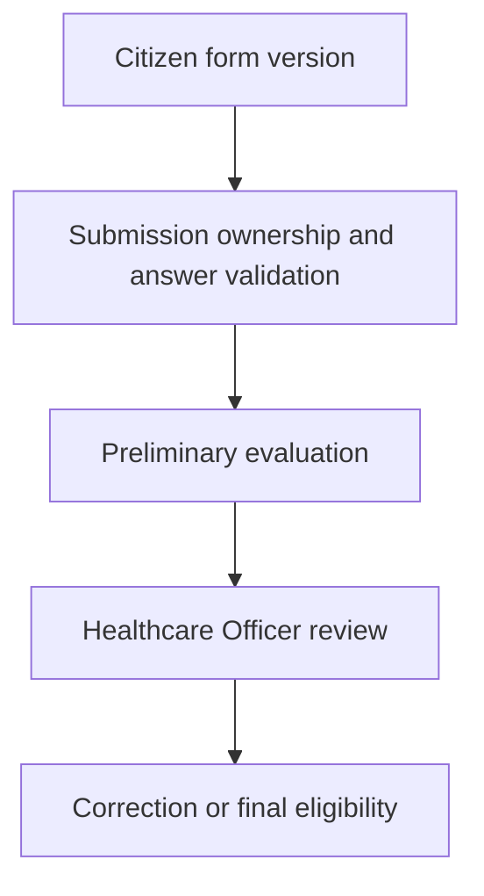

# MF01 — Screening and Eligibility design excerpt

Source basis: ScreeningSubmissionService and EligibilityReviewService; selected implementation/tests are linked in the [MF01 dossier](../../evidence/current/MF01.md).

Preliminary evaluation is not a clinical decision. Submitted answers retain their questionnaire version. Ownership and active-submission uniqueness are enforced.

This is an implemented workflow excerpt, not every planned conceptual entity. Role checks and ownership are detailed in the dossier. Physical constraints are evidenced by its linked migrations. Human confirmation is still needed for member authorship and final captures, not for the five-function model.
