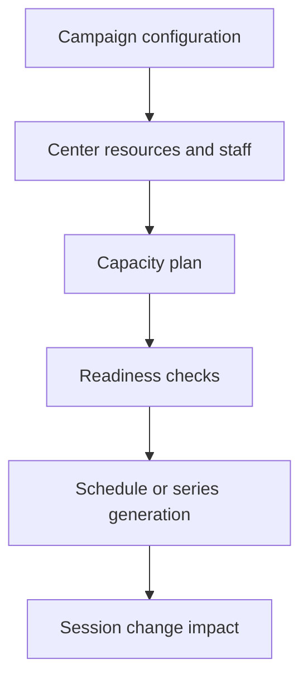

# MF02 — Campaign, Center and Session design excerpt

Source basis: VaccinationSessionService and SessionOperationalReadinessService; selected implementation/tests are linked in the [MF02 dossier](../../evidence/current/MF02.md).

Scheduling rechecks readiness. Resource/staff conflicts and capacity rules apply. Schedule changes preserve affected-booking responsibilities through the Appointment provider boundary.

This is an implemented workflow excerpt, not every planned conceptual entity. Role checks and ownership are detailed in the dossier. Physical constraints are evidenced by its linked migrations. Human confirmation is still needed for member authorship and final captures, not for the five-function model.
