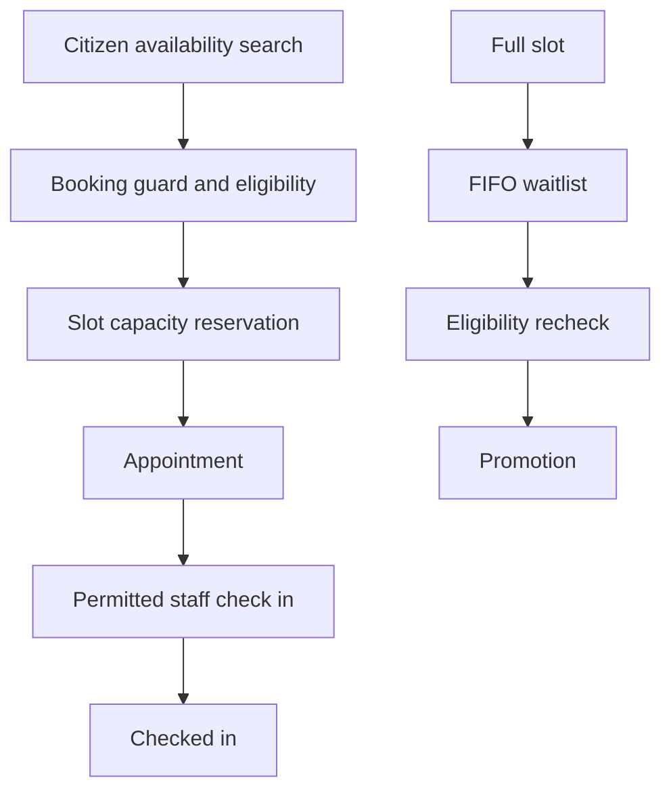

# MF03 — Appointment, Waitlist and Check-In design excerpt

Source basis: AppointmentBookingService and WaitlistPromotionService; selected implementation/tests are linked in the [MF03 dossier](../../evidence/current/MF03.md).

Booking retains citizen/campaign guard and eligibility checks before reserving capacity. Waitlist ordering is FIFO. Object ownership is enforced separately from role checks.

This is an implemented workflow excerpt, not every planned conceptual entity. Role checks and ownership are detailed in the dossier. Physical constraints are evidenced by its linked migrations. Human confirmation is still needed for member authorship and final captures, not for the five-function model.
