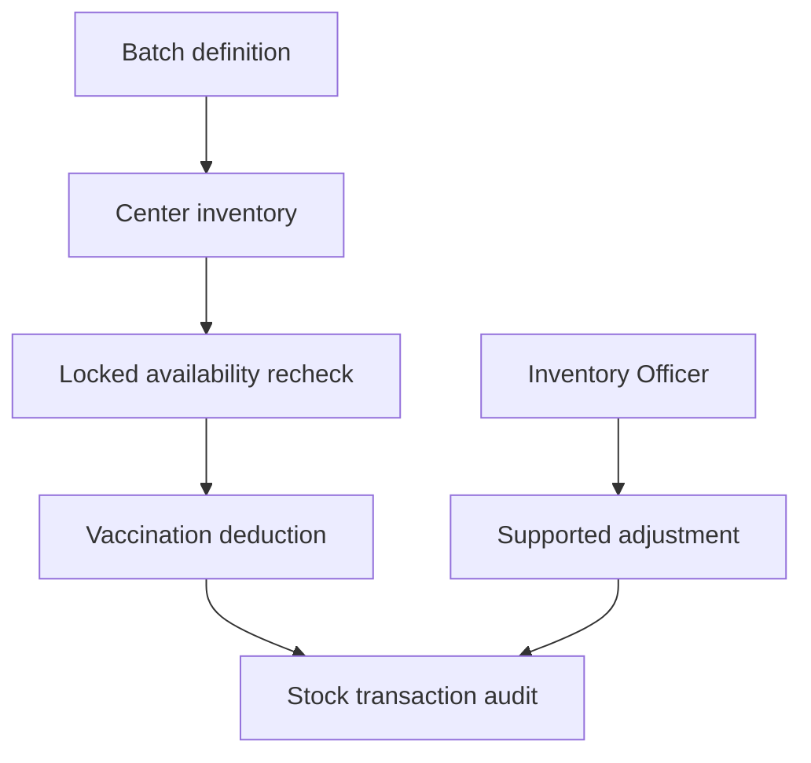

# MF04 — Inventory and Batch design excerpt

Source basis: InventoryBatchPort and inventory service integration tests; selected implementation/tests are linked in the [MF04 dossier](../../evidence/current/MF04.md).

Draft editing does not change stock. Finalization deduction joins the caller transaction, revalidates availability under locks and records a unique vaccination deduction. Do not assume every planned inventory capability is present.

This is an implemented workflow excerpt, not every planned conceptual entity. Role checks and ownership are detailed in the dossier. Physical constraints are evidenced by its linked migrations. Human confirmation is still needed for member authorship and final captures, not for the five-function model.
