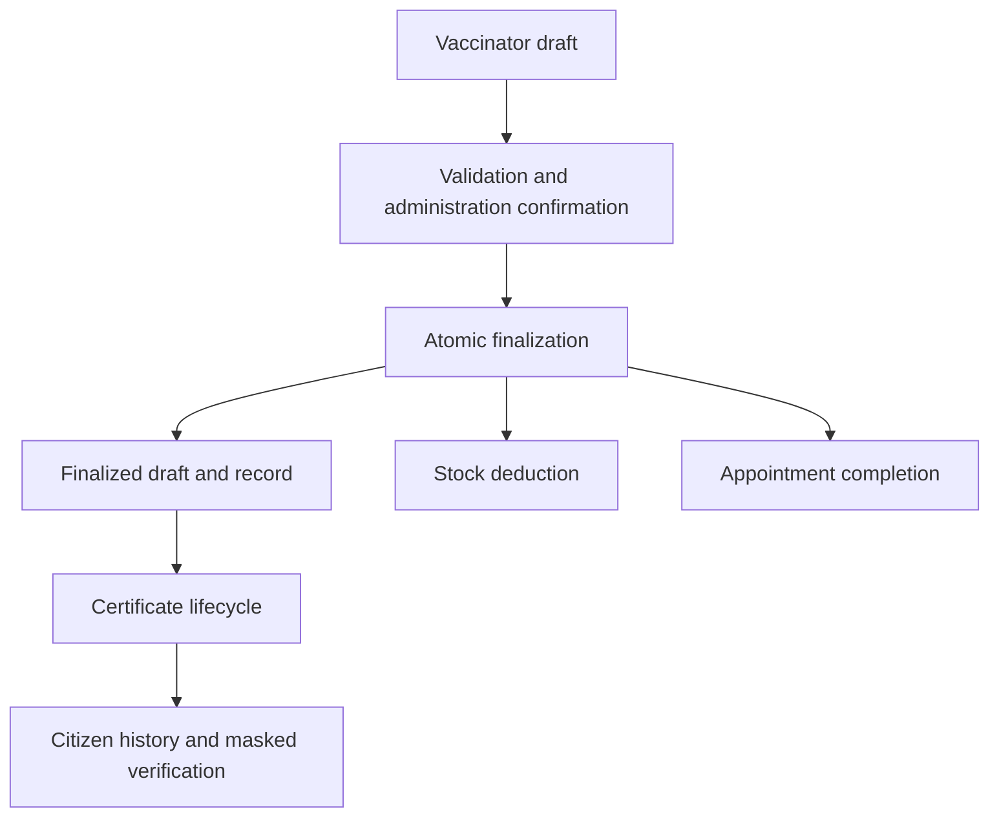

# MF05 — Administration, Drafts and Certificates design excerpt

Source basis: VaccinationFinalizationService and DigitalCertificateController; selected implementation/tests are linked in the [MF05 dossier](../../evidence/current/MF05.md).

Finalization requires a valid draft, checked-in appointment and compatible available batch. A unique record prevents duplicate completion. Certificate lifecycle includes revocation/reissue; a record can have multiple historical issues.

This is an implemented workflow excerpt, not every planned conceptual entity. Role checks and ownership are detailed in the dossier. Physical constraints are evidenced by its linked migrations. Human confirmation is still needed for member authorship and final captures, not for the five-function model.
