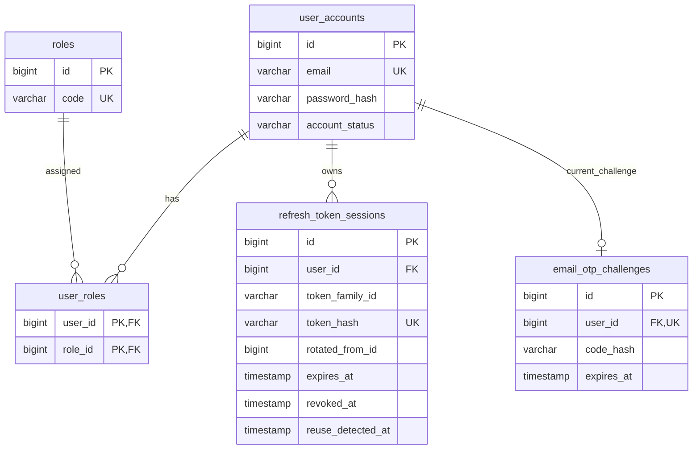

# Implemented physical ER excerpt

Deliberately scoped to shared auth tables and actual foreign keys in [V4](../../../backend/src/main/resources/db/migration/V4__shared_authentication_foundation.sql) and [V22](../../../backend/src/main/resources/db/migration/V22__add_email_verification.sql). Function-specific implemented data/constraints are linked from MF dossiers; this is not a complete database ERD.

rotated_from_id is a stored predecessor identifier; V4 does not declare a self-FK. [V24](../../../backend/src/main/resources/db/migration/V24__add_refresh_token_sessions_family_revocation_index.sql) adds the (token_family_id, revoked_at) family-revocation index. Raw refresh tokens and OTPs are absent from persisted fields. The full runtime schema is V0–V26, 27 migrations.
