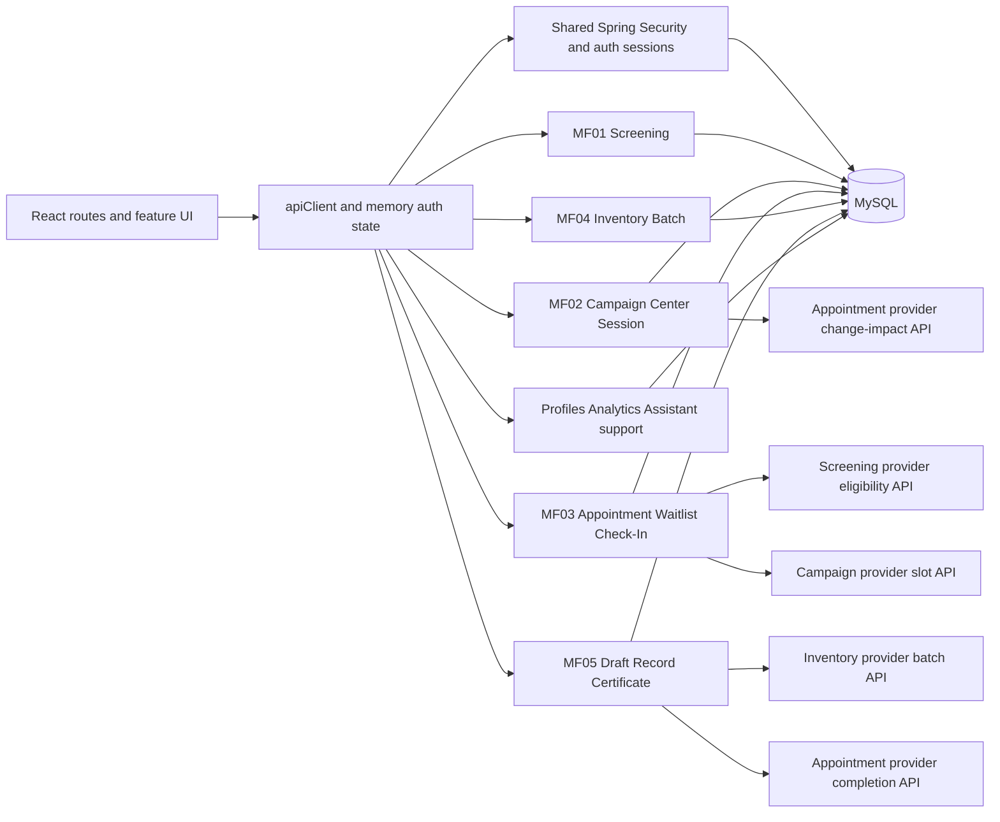

# Modular-monolith component view

Source: [current architecture](../../Web_Based_Vaccination_Portal_Recommended_Full_File_Tree.md). Provider-owned dependency ports separate modules; this diagram is not a deployment topology.

Module arrows represent provider APIs, not permission to import another module's repository. Assistant external model provider configuration is optional; no external host is asserted.
